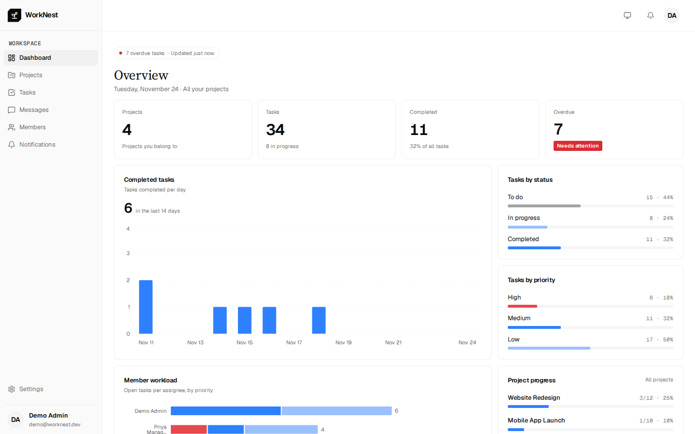
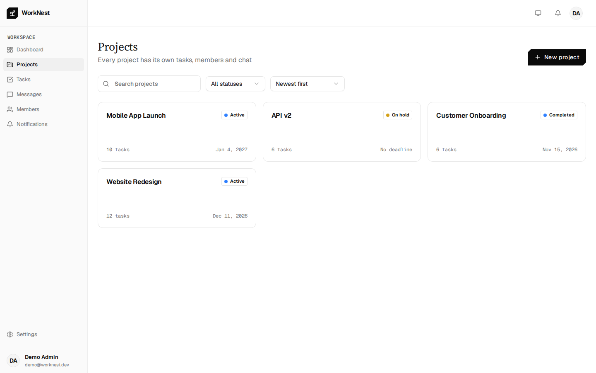
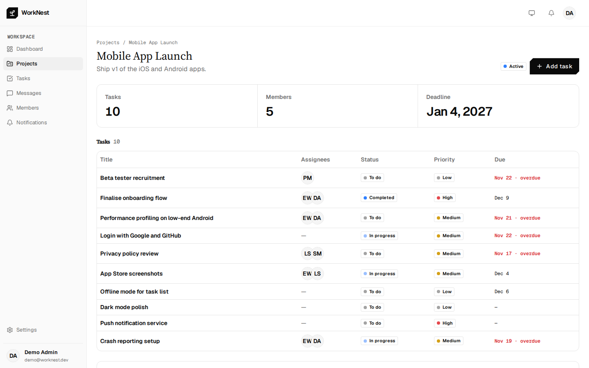
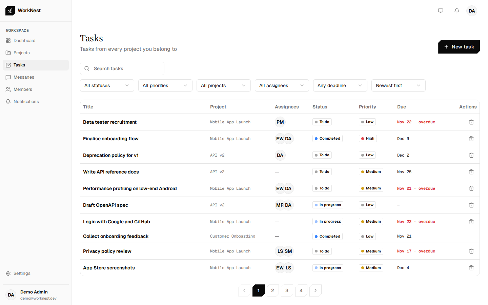
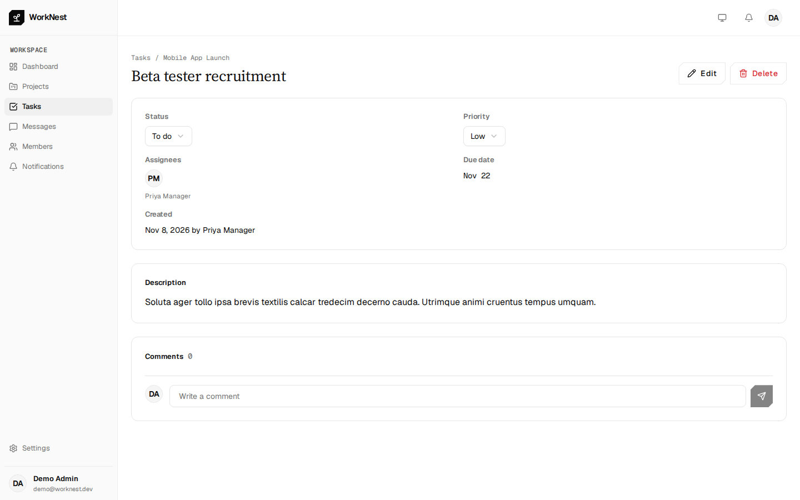
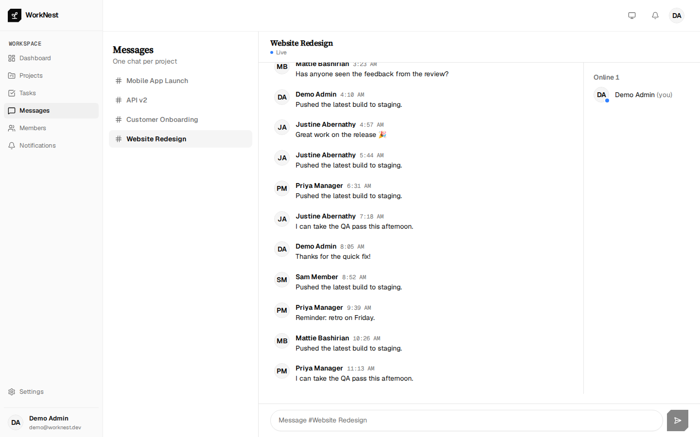
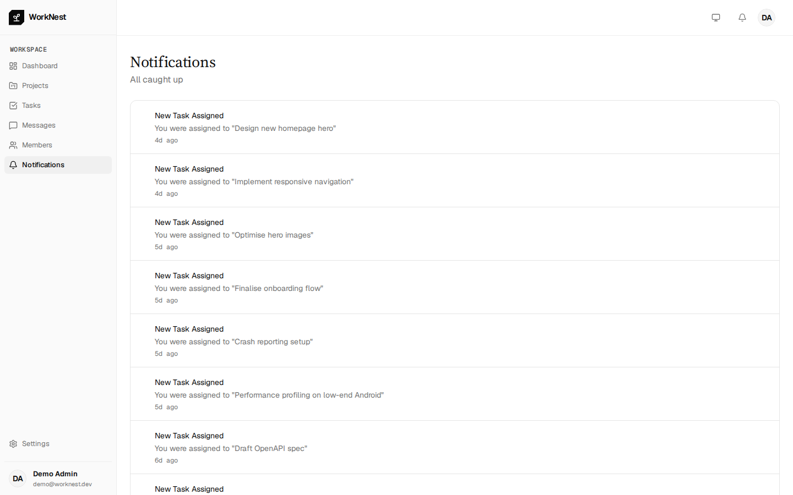
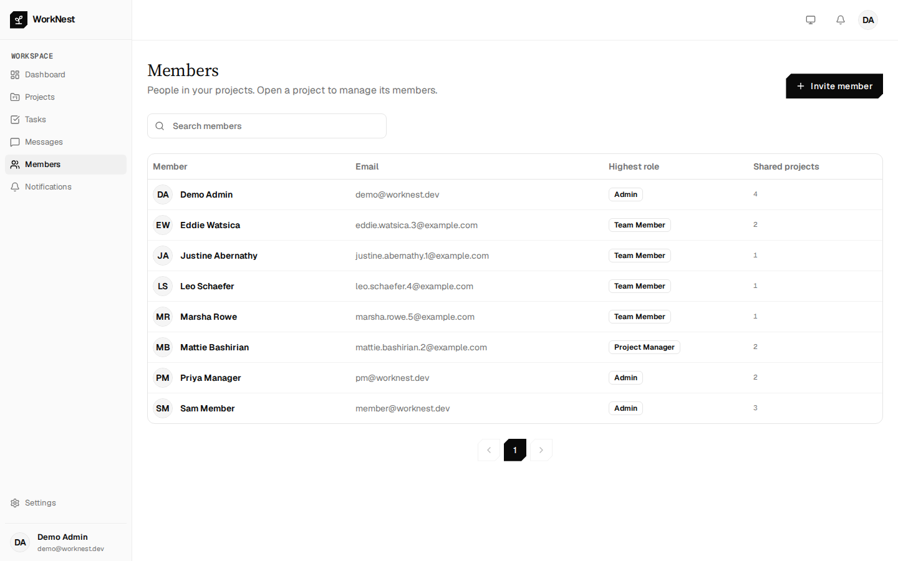

<div align="center">

# WorkNest

**A team collaboration app for projects, tasks and real-time project chat. It runs as a single Cloudflare Worker.**

[**Live Demo**](https://worknest.sadal.dev/) · [Screenshots](#screenshots) · [Stack](#stack) · [Quick start](#quick-start)


<br />



</div>

---

- **Projects:** members, invitations, status, deadlines, search, filter, sort and pagination.
- **Tasks:**
  - multiple assignees, priority, status and deadlines
  - comments that can be edited and deleted
  - filters for status, priority, project, assignee and deadline (overdue or this week)
- **Dashboard:**
  - KPI cards
  - team productivity, project progress and member workload charts
  - status and priority breakdowns
  - recent activity and upcoming deadlines
- **Project chat:** one real-time room per project, backed by a Durable Object with WebSocket hibernation. History is stored in D1.
- **Notifications and activity log:** stored in D1 and refreshed with TanStack Query.
- **Per-project roles:** `ADMIN`, `PROJECT_MANAGER` and `TEAM_MEMBER`, enforced on the server.
- **Auth:** Google or GitHub OAuth, plus optional one-click sign-in to the seeded demo accounts.
- **Themes and layout:** light and dark themes (Mono design system), with responsive desktop, tablet and phone layouts.

## Screenshots

All screenshots show the seeded demo data (4 projects, 34 tasks), signed in as the demo admin.

<table>
  <tr>
    <td width="50%">
      <br />
      <b>Dashboard.</b> KPI cards, tasks completed per day, status and priority breakdowns, member workload and project progress.
    </td>
    <td width="50%">
      <br />
      <b>Projects.</b> Every project you belong to, with status, task count and deadline, plus search, status filter and sort.
    </td>
  </tr>
  <tr>
    <td width="50%">
      <br />
      <b>Project detail.</b> Task, member and deadline summary, with the project's task table and overdue dates flagged.
    </td>
    <td width="50%">
      <br />
      <b>Tasks.</b> Tasks from every project, filtered by status, priority, project, assignee and deadline, with pagination.
    </td>
  </tr>
  <tr>
    <td width="50%">
      <br />
      <b>Task detail.</b> Inline status and priority, assignees, due date, description and a comment thread.
    </td>
    <td width="50%">
      <br />
      <b>Project chat.</b> One live room per project over WebSockets, with message history and who is online.
    </td>
  </tr>
  <tr>
    <td width="50%">
      <br />
      <b>Notifications.</b> Task assignments, status changes and new comments, stored in D1 and refreshed with TanStack Query.
    </td>
    <td width="50%">
      <br />
      <b>Members.</b> Everyone in your projects, with their highest project role and how many projects you share.
    </td>
  </tr>
</table>

## Stack

| Layer         | Tech                                                                                          |
| ------------- | --------------------------------------------------------------------------------------------- |
| Framework     | [TanStack Start](https://tanstack.com/start) (React 19, file-based routing, server functions) |
| Runtime       | Cloudflare Workers (`@cloudflare/vite-plugin`)                                                |
| Database      | Cloudflare D1 + Drizzle ORM                                                                   |
| Real-time     | Durable Objects (`ChatRoom`), WebSocket hibernation                                           |
| Auth          | Better Auth                                                                                   |
| UI            | Tailwind CSS v4, shadcn/ui, Recharts                                                          |
| Data fetching | TanStack Query                                                                                |
| Media         | Cloudinary (profile photos only)                                                              |

## Quick start

Requirements: Node 20+ and pnpm.

```bash
pnpm install
cp .dev.vars.example .dev.vars          # then fill in the values (see below)
pnpm wrangler d1 migrations apply worknest-db --local
pnpm db:seed                             # demo users, projects, tasks, chat
pnpm dev                                 # http://localhost:3000
```

### Demo accounts

`pnpm db:seed` creates three accounts. The login page has a **Try a demo account** panel with one button per account: click one to sign in as that role. There is no email/password form; the buttons sign in with the shared demo password (**`worknest-demo`**) behind the scenes.

| Email                 | What you can try                                                                 |
| --------------------- | -------------------------------------------------------------------------------- |
| `demo@worknest.dev`   | Admin of _Website Redesign_ and _API v2_, project manager on _Mobile App Launch_ |
| `pm@worknest.dev`     | Admin of _Mobile App Launch_, project manager on _Website Redesign_              |
| `member@worknest.dev` | Team member on most projects (sees the restricted UI)                            |

The demo panel only appears when `ENABLE_EMAIL_PASSWORD=true`; the example `.dev.vars` sets it. Email sign-up is disabled, so new users register through Google or GitHub. The seed is idempotent: it only creates rows whose id starts with `demo-`, and re-running it resets them.

### Environment

Local values go in `.dev.vars`. Production secrets are set with `wrangler secret put <NAME>`.

| Variable                                             | Required    | Notes                                                                  |
| ---------------------------------------------------- | ----------- | ---------------------------------------------------------------------- |
| `BETTER_AUTH_SECRET`                                 | yes         | Any long random string (`openssl rand -base64 32`)                     |
| `BETTER_AUTH_URL`                                    | yes in prod | `http://localhost:3000` locally; set in `wrangler.jsonc` vars for prod |
| `GOOGLE_CLIENT_ID` / `GOOGLE_CLIENT_SECRET`          | one method  | OAuth callback: `<BETTER_AUTH_URL>/api/auth/callback/google`           |
| `GITHUB_CLIENT_ID` / `GITHUB_CLIENT_SECRET`          | one method  | OAuth callback: `<BETTER_AUTH_URL>/api/auth/callback/github`           |
| `ENABLE_EMAIL_PASSWORD`                              | one method  | `"true"` shows the one-click demo account panel. Defaults to `"false"` |
| `CLOUDINARY_CLOUD_NAME` / `_API_KEY` / `_API_SECRET` | no          | Only needed for profile photo uploads                                  |

At least one sign-in method must be configured: Google, GitHub, or email.

## Scripts

| Command                    | What it does                                                |
| -------------------------- | ----------------------------------------------------------- |
| `pnpm dev`                 | Dev server on :3000, running inside workerd                 |
| `pnpm build`               | Production build to `dist/`                                 |
| `pnpm lint` / `pnpm check` | ESLint / Prettier check (`pnpm format` fixes both)          |
| `npx tsc --noEmit`         | Type check (there is no test runner)                        |
| `pnpm db:generate`         | Generate a migration from schema changes (`migrations/`)    |
| `pnpm db:seed`             | Seed demo data into local D1 (`-- --remote` for production) |
| `pnpm cf-typegen`          | Regenerate binding types after editing `wrangler.jsonc`     |
| `pnpm deploy`              | Build, apply remote D1 migrations, deploy the Worker        |

## Project structure

```
src/
  routes/              File-based routes (_authenticated.tsx guards the app)
  server-functions/    All data access: createServerFn + authMiddleware
  lib/                 auth, authz (project roles), middleware, activity, password
  db/schema/           Drizzle tables, one file per domain
  chat/                ChatRoom Durable Object, WebSocket upgrade, wire protocol
  components/          UI (shadcn in components/ui, feature folders alongside)
migrations/            D1 SQL migrations (applied by pnpm deploy)
scripts/seed.ts        Demo data
context/               Product spec, design system, process tracker
```

Authorization is **per project**. Every server function goes through `authMiddleware`, which requires a session, and then checks the caller's `project_member.role` with `requireProjectRole`. See `CLAUDE.md` for the architecture notes.

## Deploying to Cloudflare

These are one-time steps. Run them yourself, because they change production.

```bash
pnpm wrangler login
pnpm wrangler d1 create worknest-db          # put the database_id in wrangler.jsonc
for s in BETTER_AUTH_SECRET GOOGLE_CLIENT_ID GOOGLE_CLIENT_SECRET \
         GITHUB_CLIENT_ID GITHUB_CLIENT_SECRET \
         CLOUDINARY_CLOUD_NAME CLOUDINARY_API_KEY CLOUDINARY_API_SECRET; do
  pnpm wrangler secret put $s
done
```

Then, for every release:

```bash
pnpm deploy          # build + apply remote migrations + wrangler deploy
```

### Existing database: one-time upgrade to `version_1`

The migration history was squashed into `migrations/0000_version_1.sql`. A brand-new D1 database just runs it through `pnpm deploy`. The existing `worknest-db` already applied the old `0000`–`0005`, so it needs one upgrade **before** the next deploy:

```bash
pnpm wrangler d1 migrations list worknest-db --remote          # must show only the old 0006–0009 as pending
pnpm wrangler d1 export worknest-db --remote --output prod-backup.sql
pnpm wrangler d1 execute worknest-db --remote --file scripts/prod-upgrade-to-version1.sql
pnpm wrangler d1 migrations list worknest-db --remote          # now: "No migrations to apply"
```

### Demo data in production (optional)

```bash
# 1. In wrangler.jsonc vars: "ENABLE_EMAIL_PASSWORD": "true"
pnpm deploy                 # ships the flag
pnpm db:seed --remote       # creates the demo-* rows in the remote D1
```

Anyone who knows the demo password (`worknest-demo`) can then sign in, so change `DEMO_PASSWORD` in `scripts/seed.ts` first if the site is public. To remove the demo data later, delete the `demo-%` rows: `pnpm wrangler d1 execute worknest-db --remote --command "DELETE FROM project WHERE id LIKE 'demo-%'; DELETE FROM user WHERE id LIKE 'demo-%';"`.

Update `BETTER_AUTH_URL` and the custom domain in `wrangler.jsonc` to match your domain, and register the OAuth callback URLs with Google and GitHub.
